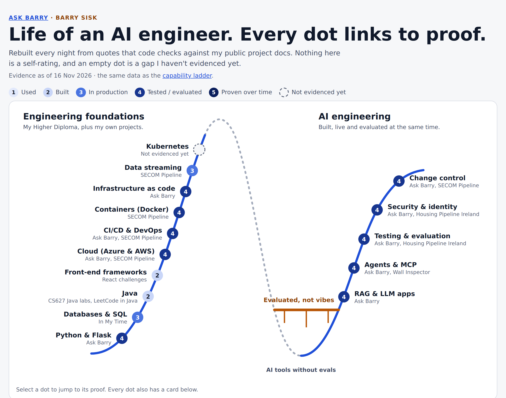
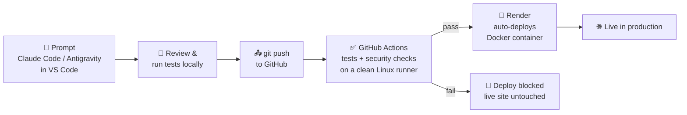

### Hi, I'm Barry 👋

**Engineer turned software developer.** I spent 30 years at Intel Ireland leading engineering teams in high-volume, tightly controlled manufacturing ([career history](career.md)). Now I build AI agents and AI-enabled applications, measure whether they work, and ship them to production.

- 🎓 Completing a **Higher Diploma in Software Development** at Maynooth University (2027)
- 🤖 I build with AI agents every day (Claude Code, Google Antigravity), and I build agents into my own apps
- 🔎 **Ask me anything about my work:** [Ask Barry](https://ask-barry.onrender.com) is my retrieval-augmented generation (RAG) assistant. It answers from my public docs and cites its sources
- 🧭 **Hiring?** [Paste your job ad](https://ask-barry.onrender.com/evidence), or photograph it on your phone: an AI agent I built maps each requirement to evidence in my project docs, with links, and you can share the result by QR code, WhatsApp or email
- 📊 **Every skill, with proof:** my [capability ladder](https://ask-barry.onrender.com/capability) rates each skill from "listed" to "tested", links each level to the section that proves it, and shows the gaps
- 📇 **Everything in one place:** [my links page](https://ask-barry.onrender.com/connect) (projects, live sites, LinkedIn, GitHub and career history)
- 🏭 **From fab to pipeline:** [how my manufacturing disciplines map onto software delivery](manufacturing-to-software.md), from SPC and change control to CI quality gates and real-time fault detection
- 🔒 I care about privacy by design, testing, and software that holds up in real use
- 💼 Open to AI engineering and forward-deployed engineering roles in Dublin

---

### 📈 Life of an AI engineer: every dot links to proof

*Rebuilt every night from quotes that code checks against my public project docs. Nothing here is a self-rating, and an empty dot is a gap I haven't evidenced yet. [Open the live curve](https://ask-barry.onrender.com/curve) to click any dot through to its proof.*

---

### ⚙️ How I build: from prompt to production in minutes

1. **Describe the change** to an AI coding agent in VS Code. It writes the code and the tests alongside it.
2. **Review it myself.** I read the diff and run the tests locally, because the agent drafts and I remain the engineer.
3. **Push to GitHub.** A CI pipeline spins up a fresh machine and runs the full test suite and security checks.
4. **Deploy only on green.** Render deploys automatically, but only after every check passes. A failing change never reaches users.

**Result:** a reviewed, tested change goes from idea to live in about two minutes, with quality gates at every step. It is the same discipline I applied to production lines at Intel: inspect at every stage, and never ship a defect downstream.

---

### 🛠️ Featured projects

**[Ask Barry](https://ask-barry.onrender.com)** · [code](https://github.com/BBSISK/ask-barry)
A retrieval-augmented generation (RAG) assistant, live in production, that answers questions about my projects using only my public GitHub documentation. It cites the repo, file and section behind every answer, and says so when the docs don't support a claim.
- **Measured, not assumed:** a golden test set with trap questions, section-level retrieval metrics, and an AI judge whose quoted evidence is checked in code. I also compared Azure OpenAI, Claude and Gemini on identical evidence, and re-ran the evaluation on AWS Bedrock.
- **I tested the judge too:** I hand-labelled 55 claims, including planted near-misses with one detail changed, and measured my GPT-4.1-mini judge against a second judge of a different kind, TypeSafe's Jev decision model. They agreed on 54 of 55; Jev cost about a seventh as much and its confidence score flags the few uncertain claims for a person. The labelling also showed that I miss single changed details more often than either judge, which is the reason automated checks exist.
- **Evaluation finds real bugs:** asked about "maps SDKs", the agent called the skill supported because a README mentioned an "evidence map". A prompt rule wasn't enough, since the model also read a "planned" section as finished work, so I moved the rule into code and added a trap question as a regression test.
- **Runs itself:** a nightly GitHub Action re-indexes the docs and fails if retrieval accuracy drops. The Azure resources are managed in Terraform, and a model card documents its limits and an EU AI Act assessment.
- **Usable by other AI assistants:** a hosted MCP server lets Claude and ChatGPT query it directly.
- **An AI agent on top, built twice:** it reads a [job ad](https://ask-barry.onrender.com/evidence), calls Ask Barry over MCP once per requirement and returns an evidence map with links. I built it in Microsoft Agent Framework (live) and rebuilt it in LangGraph with parallel tool calls and a human-review mode. On the same 10 ads both reached 98% accuracy, and LangGraph used about 40% more tool calls. Its guardrails are enforced in code: every "evidenced" row must cite a link the tool actually returned, only the one tool is allowed, runs have a budget, and it never scores or ranks a candidate. Evaluated against a no-agent baseline: no false evidence in either, and 100% vs 92% status accuracy. A skill listed only on this profile is labelled "Listed on profile", not evidenced, because a self-description isn't proof of work.
- **Built for use on the spot:** the evidence page runs the agent as a background job and shows each question it asks; a phone camera can scan a printed job ad (the text is shown for checking before anything runs); results can be shared by QR code, WhatsApp or email through a signed link, with no database.

`Azure AI Search` `Azure OpenAI` `RAG` `Embeddings` `LLM evaluation` `Terraform` `GitHub Actions` `MCP server` `Microsoft Agent Framework` `LangGraph` `AI agents` `LLM-as-judge` `TypeSafe Jev` `Amazon Bedrock`

**[Agent Quest](https://github.com/BBSISK/agent-quest-java)**
An AI game-master agent written in Java on Amazon Bedrock with no agent framework: a hand-written agentic loop on the Converse API with four tools, tested with 24 JUnit tests against a scripted fake model. I benchmarked two models on the same scripted game, judged from the tool log: Claude Haiku 4.5 recorded 9 of 9 required state changes and Amazon Nova 2 Lite recorded 0 of 9, even with an explicit prompt rule. Choosing the model mattered more than the prompt.
- **Now with a memory in the cloud:** a Spring Boot REST API saves every game to MySQL on **Amazon RDS**. Five tables with foreign keys and CHECK constraints (the database itself refuses negative gold), parameterised SQL through JdbcTemplate, and each turn saved in one transaction with its tool calls. Proved live with a restart test: the server was stopped and started, and the game came back from RDS with its gold and its story. 44 tests run on every push against an in-memory database, with no AWS needed. A React front end is next.

`Java` `AWS SDK for Java v2` `Amazon Bedrock` `Spring Boot` `REST API` `Amazon RDS` `MySQL` `JDBC` `JUnit` `GitHub Actions`

**[Wall Inspector](https://github.com/BBSISK/wall_inspector)**
AI-assisted skills-assessment platform for civil engineering, heritage conservation and masonry students. Students identify defects in masonry photographs, classify severity and recommend conservation solutions, graded in real time against expert benchmarks. Every AI proposal is tracked as auto-suggested, assessor-accepted or human-graded.
`Flask` `PostgreSQL` `Docker` `Terraform` `GitHub Actions` `Gemini vision` `Human-in-the-loop AI` `MCP server` `COCO / YOLOv8 export`

**[Degree Drift](https://degree-drift.onrender.com/)** · [code](https://github.com/BBSISK/degree-drift)
An interactive data-journalism dashboard that follows Irish university graduates into the sectors of the economy where they work, 1 to 10 years after graduation. It is built on Central Statistics Office (CSO) data linked to Revenue tax records, by field of study and institution. It shows, for example, that at Year 5 more Business (26.9%) and Arts & Humanities (22.6%) graduates work in Irish tech than ICT graduates (24.4%).
- **Honest with small numbers:** the CSO suppresses small cells to protect privacy, and I leave those out rather than estimate them, so a missing flow means the figure was not published.
- **Built to be fast and checked:** a Python standard-library pipeline reads three CSO tables (HEO08, HEO12, HEO16) once and writes one compact file, so the site never calls the CSO API. A custom D3 Sankey diagram shows the flows, TypeScript runs in strict mode, and GitHub Actions builds and deploys every push.
`React` `TypeScript` `Vite` `D3 (Sankey)` `Tailwind CSS` `Python` `CSO open data` `GitHub Actions`

**[The 7pm "Stove Inversion"](https://stove-inversion.onrender.com/)** · [code](https://github.com/BBSISK/stove-inversion)
An interactive dashboard of live air-quality readings from all 113 EPA Ireland monitoring stations, asking why quiet regional towns such as Ennis, Tralee and Longford see winter fine-particle (PM2.5) spikes far above Dublin's. On the 2 November peak it found Ennis at 198.1 µg/m³ against 9.1 µg/m³ at Phoenix Park in the same hour, about 22 times higher and 13 times the WHO 24-hour guideline. In the data the peaks fall in the evening window of 19:00 to 21:00 UTC, not at commuter rush hours, which points to home heating (turf, briquettes, wood) trapped by cold, still nights, set against Dublin's long-standing smoky-coal ban and gas network. It is a public-health story told with public data.
- **Built to be read:** a custom SVG map of Ireland with all 113 stations, time-series charts against the WHO threshold, and 24-hour averages. A Python scraper pulls the readings from the EPA's public air-quality service, and GitHub Actions deploys the site.
`React` `TypeScript` `Tailwind CSS` `Python` `SVG data visualisation` `EPA open data` `GitHub Actions`

**[Housing Pipeline Ireland](https://github.com/BBSISK/housing-pipeline-ireland)** · in progress
A data pipeline that joins three public Irish sources never designed to fit together: the Property Price Register (810,390 sales), South Dublin planning applications (33,304) and Oireachtas parliamentary questions (5,420, of which 349 went to Housing). Sprint 1 is done: every raw file is landed unchanged with a SHA-256 hash and row count, and a [data profile](https://github.com/BBSISK/housing-pipeline-ireland/blob/main/docs/data-profile.md) documents 15 quality issues, with a dashboard of the findings. Along the way I caught my own flawed metric (a "contains a figure" check that read 349 of 349 and fell to 119 of 349 once boilerplate was stripped). Azure storage is built in Terraform with keyless upload. Next: geocoding, matching permissions to later sales, an MCP server and an evaluated Q&A agent.
`Python` `Azure Blob Storage` `Terraform` `GitHub Actions` `Data quality` `Open data` `Data visualisation`

**[SECOM Semiconductor Pipeline](https://github.com/BBSISK/SECOM_Pipeline)** · in progress
A streaming replay of the public SECOM fab dataset (1,567 runs, 590 sensors) aimed at statistical process control monitoring, on AWS. Sprint 1 is done: the data is profiled, there is a record contract with ten reject reasons, a replay producer with fault injection, and a container shipped to ECR by GitHub OIDC (no stored keys) and blocked on critical vulnerabilities. Next: Kinesis, Lambda and SPC monitoring.
`AWS` `Terraform` `GitHub OIDC` `Docker` `Python` `SPC`

**[In My Time](https://www.inmytime.app)**
WhatsApp-based family-history service built on a privacy-first architecture: a grandparent answers one weekly question at a time and the answers pass to a family member, without the content ever being stored. The older person gives her own consent, the questions never assume a conventional life, and the system never assumes someone has died. The StoryCatcher feature lets relatives record interviews together, with per-interviewee access control, client-side encryption and families keeping recordings in their own Google Drive. German localisation, automated API and browser test suites.
`Flask` `WhatsApp Business API` `Cloudflare R2` `Playwright` `Flask-Babel`

**[Taxi of Mum & Dad](https://taxi-mum-dad-eu.onrender.com)** · [code](https://github.com/BBSISK/taxi-mum-dad)
A family web app that turns the lift into a game: a parent starts a meter, the app times and measures the trip, and the kids' tab grows with cheeky surcharges ("Backseat driver +3"). Kids pay it off with jobs: a tidy room, a visit to Granny, an outdoor afternoon instead of games. It is designed around real family life: kids have no login (their secret receipt link is their only way in), receipts go by WhatsApp or QR code, credits come off only when a parent confirms, and the data is EU-hosted and minimal. Now in early testing with families.
- **In-car games for the whole family:** Car Bingo (I-spy from an Irish car window, memorise then hide) and County Collector (spot number plates and fill a passport of the 26 Republic counties). They are hands-free by voice, with tap buttons as a fallback, and no audio or transcripts reach the server. Getting voice to work alongside a car radio is still being tested on real drives.
- **Built to be trusted:** installable PWA, GDPR export and delete for a child or a family, 36 pytest tests plus Playwright browser tests with simulated speech.
`Flask` `PostgreSQL` `PWA` `Web Speech API` `Playwright` `GDPR`

**[AgentMath](https://www.agentmath.app)**
Adaptive maths learning platform for Irish Junior Cycle students (aged 12 to 16), with 3,000+ assessment items, classroom games, teacher dashboards that show where students are stuck, and personalised assignments.
`Flask` `SQLite` `JavaScript`

**[Brief](https://www.my30words.com)**
A weekly journaling app: 30-word snapshots of your life, delivered by WhatsApp and email, building a personal record of change over time.
`Flask` `Twilio` `Google & Microsoft OAuth` `PWA`

---

### 🎓 Studying now: H.Dip. in Software Development, Maynooth University (2026–27)

| Semester 1 (Sept–Dec 2026) | Semester 2 (Jan–May 2027) |
|---|---|
| Structured Programming (Java) | Algorithms & Data Structures 2 |
| Algorithms & Data Structures 1 | Web Information Processing (REST, full stack) |
| Software Testing (JUnit) | Software Project (Scrum team, DevOps) |
| Databases | Work Placement Preparation |
| Mobile Application Development (React) | |
| Computer Systems | |

Year-long: Object-Oriented Programming across multiple languages. I publish coursework code here once each module has been assessed.

---

### 🧰 Toolbox

**Languages:** Java (I write it by hand: HDip coursework, and Agent Quest's agent loop and tools) · SQL · Python · JavaScript · HTML/CSS (Python and web code built with Claude Code: I specify, review, test and deploy every change) · TypeScript and React (Degree Drift dashboard, practice and course work) · D3
**Frameworks:** Flask · Gunicorn · Spring Boot (REST API, JdbcTemplate; learning)
**Data:** PostgreSQL · MySQL (Amazon RDS) · SQLite · data modelling & migrations · vector & hybrid search · open-data pipelines (CSO, Property Price Register, planning data) · data profiling and quality · data visualisation (D3)
**Cloud & DevOps:** Docker · Terraform · GitHub Actions (CI/CD, GitHub OIDC) · Render · Microsoft Azure (Entra ID) · AWS (Bedrock, RDS, ECR, IAM) · Cloudflare · Cloudinary
**AI:** RAG · Azure OpenAI · Azure AI Search · Amazon Bedrock · LLM evaluation (LLM-as-judge, hand-labelled agreement testing) · AI agents (Microsoft Agent Framework, LangGraph, a hand-written Java agent loop, tool calling, guardrails, agent evaluation) · MCP · TypeSafe Jev (Cloudflare Workers AI) · Claude Code · Claude API · Gemini API
**Integrations:** REST APIs · webhooks · Twilio / WhatsApp · OAuth (Google, Microsoft/Azure)

---

### 📫 Get in touch

📧 barry.b.sisk@gmail.com
🔗 [LinkedIn](https://www.linkedin.com/in/barry-s-50135113/)
